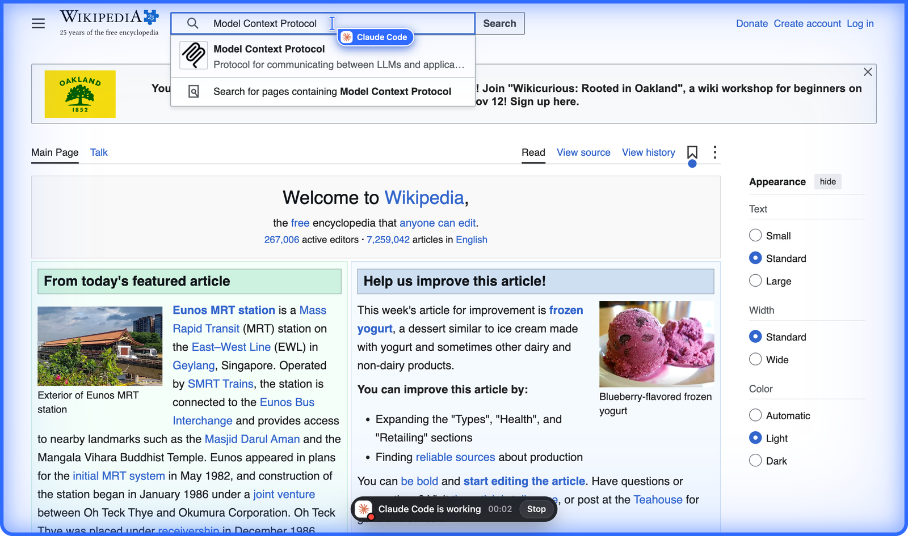
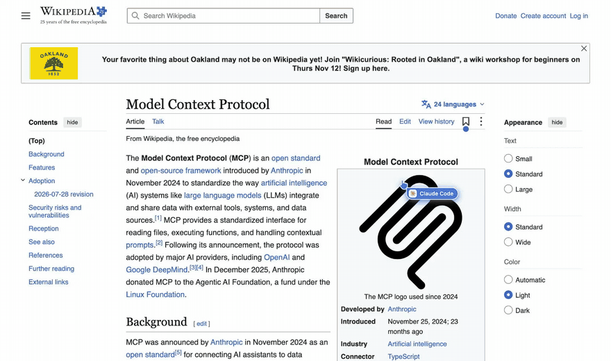
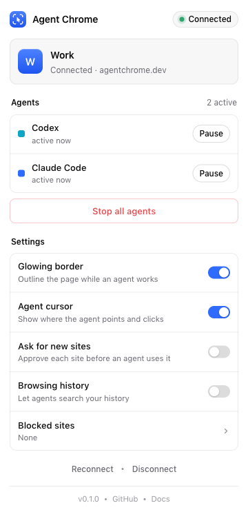
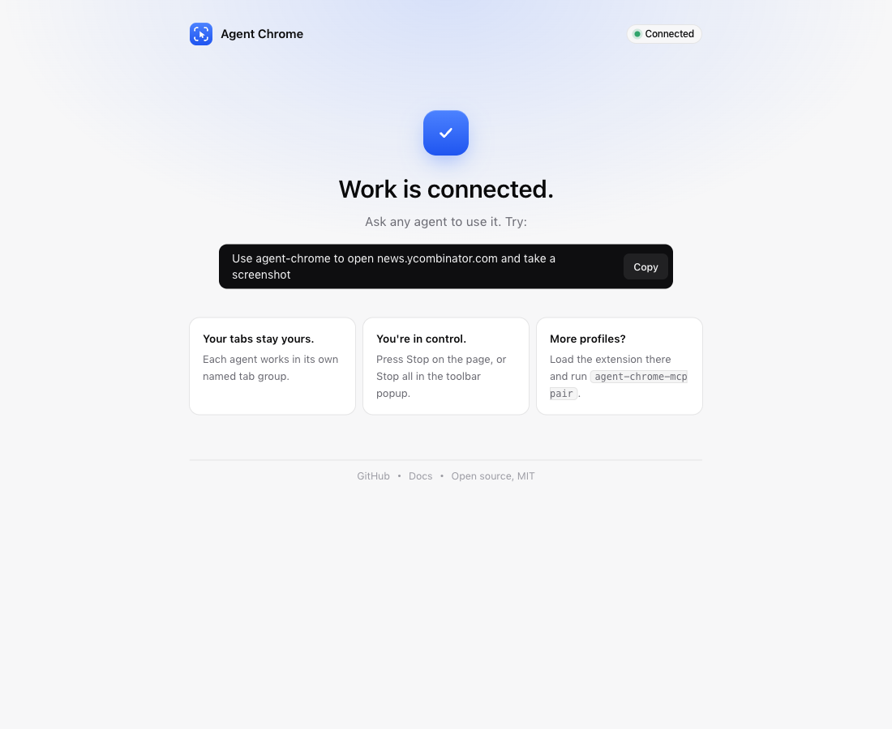

<p align="center">
  
</p>

<h1 align="center">agentchrome</h1>

<p align="center"><b>Let your coding agents use the Chrome you already use.</b></p>

<p align="center">
  <a href="https://github.com/ShadowWalker2014/agentchrome/stargazers"></a>
  <a href="LICENSE"></a>
  <a href="https://agentchrome.dev"></a>
</p>

<p align="center">
  <a href="#install">Install</a> ·
  <a href="AGENT_INSTALL.md">Let your agent install it</a> ·
  <a href="#what-it-does">What it does</a> ·
  <a href="#tools">Tools</a> ·
  <a href="#security">Security</a>
</p>

<p align="center">
  <a href="https://github.com/ShadowWalker2014/agentchrome"></a>
</p>

Agent Chrome is a Chrome extension and an MCP server that let coding agents use your real, signed-in Chrome profiles. It works with Claude Code, Codex, Gemini CLI, Antigravity, Grok, Muse, Cursor, opencode and any other MCP client. Each agent works in its own tab group, and a blue border and an animated cursor show what it is doing. It can take screenshots and record video clips, and you can connect several Chrome profiles at once. The server runs on Cloudflare, or locally on your machine.

<p align="center">
  
  <br><sub>What you see while an agent works. This clip was recorded by the extension itself (<a href="docs/media/agent-view.mp4">MP4</a>).</sub>
</p>

If it's useful to you, please star the repo. It helps other people find it.

## Install

You need Node.js 18 or newer and Google Chrome.

### 1. Run the installer

```sh
curl -fsSL https://agentchrome.dev/install | sh
```

On Windows, run this in PowerShell instead:

```powershell
irm https://agentchrome.dev/install.ps1 | iex
```

In one pass, the installer:

1. Creates your account and saves the key to `~/.config/agentchrome/config.json` with `chmod 600`.
2. Adds an MCP server named `agentchrome` to every agent it finds, in that agent's **user-level** config (table below).
3. Writes the `agentchrome` skill once, to `~/.agents/skills/agentchrome`, and **symlinks** it into each agent's skills folder.
4. Unpacks the extension to a visible **Agent Chrome** folder in Documents (`~/Documents/Agent Chrome` on macOS and Linux, `Documents\Agent Chrome` on Windows).
5. Prints a pairing code and copies it to your clipboard.

To keep everything on your machine with no cloud at all, add `--local`. See [Local mode](#local-mode).

### 2. Load the extension, once per Chrome profile

The installer opens `chrome://extensions` and selects the **Agent Chrome** folder in Finder or File Explorer for you. Keep the folder there: Chrome loads the extension from it.

1. In `chrome://extensions`, turn on **Developer mode**.
2. Drag the **Agent Chrome** folder onto the page, or click **Load unpacked** and choose Documents → **Agent Chrome**. Run `agentchrome extension --path` to print the full path.
3. Pin **Agent Chrome**, click it, paste the pairing code and press **Connect**.

To add another profile (Work, Personal, a client's), switch to that profile, load the same folder, and run `agentchrome pair` for a new code. Each profile appears as its own browser in `list_browsers`.

### 3. Use it

Ask any agent:

> Use agentchrome to open news.ycombinator.com, screenshot it, and record a short clip scrolling the front page.

### Or let your agent install it

Paste this into Claude Code, Codex or any other coding agent:

> Install agentchrome for me by following https://github.com/ShadowWalker2014/agentchrome/blob/main/AGENT_INSTALL.md

The agent runs the installer, then tells you the one step only you can do: loading the extension in Chrome and pasting the code.

### Use it from Claude.ai or ChatGPT

The server is a standard remote MCP server with OAuth, so chat apps can use it as a connector. You don't need the command line tool for this.

**Claude** (claude.ai, Claude Desktop, Cowork): open **Customize > Connectors > Add custom connector**, enter `https://agentchrome.dev/mcp` and press **Connect**.

**ChatGPT**: turn on **Developer mode** under **Settings > Apps & Connectors > Advanced**, then create a connector with the same URL and choose **OAuth**.

A sign-in page opens. Paste your account key, or press **Create an account** if you don't have one. Then ask in chat: *"Connect my Chrome."* The assistant calls `pairing_code` and walks you through loading the extension and pasting the code.

### Where each agent is configured

| Agent | Config written (user level) | Format |
|---|---|---|
| Claude Code | `claude mcp add --scope user` (`~/.claude.json`) | `http` with an `Authorization` header |
| Codex | `~/.codex/config.toml` | `[mcp_servers.agentchrome]` with `url` and `http_headers` |
| Gemini CLI | `~/.gemini/settings.json` | `httpUrl` and `headers` |
| Antigravity | `agy mcp add` and `~/.gemini/antigravity/mcp_config.json` | `serverUrl` and `headers` |
| Grok | `grok mcp add --scope user` (`~/.grok/config.toml`) | http with a header |
| Muse | `~/.config/muse/settings.json` | `type: "streamable-http"` |
| Cursor | `~/.cursor/mcp.json` | `url` and `headers` |
| opencode | `~/.config/opencode/opencode.json` | `type: "remote"` |
| Windsurf | `~/.codeium/windsurf/mcp_config.json` | `serverUrl` and `headers` |

The installer backs up every JSON or TOML file it edits as `<file>.bak-agentchrome`. The skill is linked into `~/.claude/skills`, `~/.codex/skills`, `~/.gemini/skills`, `~/.gemini/antigravity/global_skills`, `~/.cursor/skills` and `~/.config/opencode/skills`.

> **Gemini CLI note:** Gemini turns off every MCP server in folders you haven't trusted, so `gemini mcp list` shows "Disabled" there. Trust the folder with `/permissions` inside Gemini, and the server turns on.

### Pick agents, or use OAuth instead of a key

```sh
agentchrome install claude codex grok   # only these agents
agentchrome install --oauth             # no secret in config files; each agent signs in through the browser
```

With OAuth, agents that support MCP sign-in (Claude Code, Codex, Gemini CLI and others) open a sign-in page on first use. Paste your account key once (`agentchrome key` prints it) and the agent receives short-lived tokens, refreshed for 90 days.

### Add it by hand

```sh
claude mcp add --scope user --transport http agentchrome https://agentchrome.dev/mcp \
  --header "Authorization: Bearer $(agentchrome key)"

codex mcp add agentchrome --url https://agentchrome.dev/mcp --bearer-token-env-var AGENT_CHROME_MCP_KEY
```

Any MCP client that speaks Streamable HTTP works. Use `https://<server>/mcp` with a bearer key, or point it at the URL and let OAuth discovery do the rest.

## What it does

<table>
<tr>
<td width="50%"></td>
<td width="50%"></td>
</tr>
<tr>
<td><b>You can see what the agent is doing.</b> A blue border goes around the page, a pill shows which agent is working with a Stop button, and the agent's own cursor glides to each target. The cursor turns into a hand over links and an I-beam over text, and carries the agent's logo and name. Your own mouse is never moved.</td>
<td><b>Recordings look like a person using the page.</b> <code>record</code> leaves out the border, the pill and the name tag, and draws a normal cursor (<a href="docs/media/clean-recording.mp4">MP4</a>). Pass <code>cursor: "agent"</code> to keep the indicators, or <code>"hidden"</code> for no cursor.</td>
</tr>
<tr>
<td></td>
<td></td>
</tr>
<tr>
<td><b>Every agent gets its own tab group, named after its task</b> (for example "Fix checkout bug"). The popup lists which agents are active, and lets you pause one or stop them all.</td>
<td><b>Setup takes a minute.</b> Load the extension, paste the code from the installer, and the profile is connected.</td>
</tr>
</table>

It also handles the parts of real websites that usually break browser agents:

- **Drag and drop** works for native HTML5 drag events (Trello-style boards, file drop areas) and for pointer-based sliders and sortable lists.
- **File uploads** never open the native file picker. The agent can pass real file paths from your computer, or file contents. If a click tries to open the picker, it is held back and the agent is told to fill it.
- **`alert`, `confirm`, `prompt` and "Leave site?" dialogs** are reported to the agent instead of freezing it. A navigation the agent asks for leaves an unsaved page and says so.
- **New tabs opened by a link join the agent's group, and downloads are reported** in the result of the click that caused them.
- **Pages that fail are explained:** HTTP errors such as 404, DNS failures, crashed tabs, `chrome://` pages that extensions can't touch, and `file://` pages that need permission.
- **If you press Cancel** on Chrome's "started debugging this browser" bar, every agent stops and is told why.

## CLI

| Command | What it does |
|---|---|
| `agentchrome setup [--server URL] [--key KEY] [--local]` | Creates an account or signs in, installs into agents, links the skill, unpacks the extension, prints a pairing code |
| `agentchrome pair` | Prints a new single-use pairing code, valid for 15 minutes |
| `agentchrome status` | Shows the account, paired browsers with online state, and which agents are configured |
| `agentchrome install [ids] [--oauth]` / `uninstall [ids]` | Adds or removes the MCP server and the skill |
| `agentchrome revoke <browser-id>` | Removes a paired Chrome profile; it disconnects immediately |
| `agentchrome rotate-key` | Replaces your account key and rewrites every agent config |
| `agentchrome key` | Prints your account key |
| `agentchrome serve [--install]` | Runs the local server; `--install` starts it at login with launchd |
| `agentchrome extension [--path]` | Unpacks the extension and shows how to load it |

## Tools

The tool names match Claude in Chrome, so prompts and skills written for it work unchanged.

| Tool | What it does |
|---|---|
| `tabs_context` | Lists this session's tab group and tabs; creates a group with a tab if there is none. `all: true` lists every tab |
| `tabs_create` / `tabs_close` / `tabs_select` | Opens, closes or switches tabs inside the session group; `adopt` pulls a user tab into the group |
| `tab_groups` | Lists, creates, renames, recolors, collapses, moves or ungroups Chrome tab groups |
| `navigate` | Loads a URL and waits for it; also takes `back`, `forward` and `reload` |
| `computer` | `screenshot`, `left_click`, `right_click`, `middle_click`, `double_click`, `triple_click`, `hover` / `mouse_move`, `left_click_drag` (HTML5 and pointer drags; `start_ref` or `start_coordinate`), `type`, `key` (combos like `cmd+a`), `scroll`, `scroll_to`, `wait`, `zoom`. Accepts coordinates or element refs, plus `modifiers` |
| `screenshot` | Captures the viewport, or with `fullPage: true` one long image of the whole page. It scrolls through first so lazy images load, and stitches apps that scroll inside a panel, such as Gmail, Notion and dashboards. JPEG or PNG; `save: true` returns a download link |
| `read_page` | Returns an accessibility tree with `ref_N` handles; `filter: "interactive"`, `ref_id` to read a subtree, `viewportOnly` |
| `find` | Finds elements from a plain-language description and returns refs with coordinates |
| `form_input` | Sets inputs, selects, checkboxes, radios and contenteditable fields by ref |
| `get_page_text` | Returns the readable text of the article or main content |
| `javascript_tool` | Runs JavaScript in the page and returns the last expression; supports `await` and works under strict CSP |
| `read_console_messages` / `read_network_requests` | Returns console logs and errors, and requests with status and timing; can include response bodies |
| `file_upload` / `upload_image` | Fills a file input or drop zone with local file paths, base64 data, a URL or a screenshot, without the native file picker; leave out `ref` to fill a picker that a click tried to open |
| `record` | Records an **MP4 or WebM clip** of the tab and returns a link. `cursor`: `natural` (default, no indicators), `agent` or `hidden`; `showClicks` adds click ripples. `action: "scroll"` makes a smooth scrolling video of the whole page in one call |
| `gif_creator` | Records an animated GIF and returns it inline |
| `wait_for` | Waits until text appears or disappears, a CSS selector matches, or the URL matches |
| `handle_dialog` | Accepts or dismisses `alert`, `confirm` and `prompt` dialogs |
| `resize_window` | Resizes the browser window |
| `history_search` | Searches browsing history, only when you turn it on in the popup |
| `list_browsers` / `select_browser` | Lists paired Chrome profiles and picks one; every tool also takes `browser: "<name or id>"` |

## Feature parity

| | Claude in Chrome | Codex Chrome extension | agentchrome |
|---|---|---|---|
| Works with any MCP agent | Claude only | Codex only | **yes** |
| Tab group per agent session | yes | yes | **yes**, and the agent can rename and recolor it |
| Several Chrome profiles at once | one connected browser at a time | one profile | **yes, all at once** |
| Screenshots | yes | yes | **yes**, including zoom and long full-page images (also inside scrolling panels) |
| Video recording | GIF | no | **MP4 or WebM, plus GIF and one-call scrolling videos** |
| Console, network, JavaScript | yes | yes | **yes** |
| Per-site permission prompt | yes | yes | **yes**, off by default; also a block list |
| Visible "agent at work" indicator | yes | yes | **pulsing border, status pill and Stop button** |
| Animated agent cursor | no | yes | **yes, with the agent's logo; a hand over links** |
| Clean recordings without indicators | no | no | **yes** |
| Runs headless from scripts (`codex exec`, `claude -p`) | no | no | **yes**, since it's a remote MCP server |
| Self-hostable | no | no | **yes**: Cloudflare or local |

## Local mode

```sh
curl -fsSL https://agentchrome.dev/install | sh -s -- --local
agentchrome serve --install    # starts the local server now and at every login (macOS)
```

The server listens only on `127.0.0.1:47823` and rejects requests from web pages. In the extension popup, open **Server** and set it to `http://127.0.0.1:47823` before connecting. Screenshots and recordings are saved to `~/.agentchrome/artifacts`.

## Self-host on Cloudflare

```sh
git clone https://github.com/ShadowWalker2014/agentchrome && cd agentchrome
pnpm install
npx wrangler login
sh scripts/deploy-cloudflare.sh my-agentchrome
```

The script creates a D1 database, a KV namespace and an R2 bucket, runs the migrations, deploys the Worker with its Durable Object, sets a session secret, and prints your own install line (`curl -fsSL https://my-agentchrome.<you>.workers.dev/install | sh`). After you create your own account, set `SIGNUP_MODE` to `"closed"` so nobody else can sign up.

It runs comfortably on the Workers free tier for personal use. Durable Objects hibernate between calls, so an idle extension connection costs nothing.

## Security

- **Keys:** account keys (`acm_sk_…`) and device tokens (`acm_dt_…`) are 256-bit random values. The server stores only their SHA-256 hashes. The local config file is `chmod 600`.
- **Pairing:** a browser joins your account only with a single-use 10-character code that expires after 15 minutes, created by someone who already holds the account key. Each Chrome profile gets its own device token, which you can revoke on its own.
- **OAuth 2.1:** PKCE (S256), dynamic client registration, refresh-token rotation and RFC 9728 discovery, using [`@cloudflare/workers-oauth-provider`](https://github.com/cloudflare/workers-oauth-provider).
- **Isolation:** each account has its own Durable Object. MCP session ids are signed with HMAC and bound to the account, so one account cannot use another's session.
- **Recordings:** screenshots and videos you choose to save go to R2 behind unguessable 144-bit links and are deleted after 7 days.
- **Control in the browser:** the Stop button on the page or in the popup pauses every agent at once. You can also ask before each new site, block sites, and keep history access off, which is the default.
- **Rate limits:** sign-up, pairing and the sign-in page are rate-limited per IP address.
- **Untrusted pages:** the skill and the server instructions tell agents never to follow instructions found inside web pages.

Please report vulnerabilities through a [private GitHub security advisory](https://github.com/ShadowWalker2014/agentchrome/security/advisories/new).

## How it works

```
Claude Code ─┐                    ┌──────────────────────────────┐        ┌─ Chrome "Work" profile
Codex ───────┤  MCP over HTTPS    │ Cloudflare Worker            │  WSS   │   (extension, paired)
Gemini ──────┼──────────────────► │  /mcp  OAuth 2.1 or API key  │ ◄────► ├─ Chrome "Personal" profile
Grok, Muse … ┘                    │  Durable Object per account  │        └─ …
                                  └──────────────────────────────┘
```

The extension keeps one WebSocket open to the server. The server runs on Cloudflare Workers with one Durable Object per account. Each MCP session gets its own tab group in every paired profile. Tools that act on a page use the Chrome debugger protocol for input, screenshots, console and network logs. A small content script provides element refs, the accessibility tree, the overlay and the agent cursor.

## Development

```sh
pnpm install
pnpm --filter @agentchrome/server exec wrangler d1 migrations apply agent-chrome-mcp --local
pnpm dev:server                         # Worker on http://127.0.0.1:8787
node scripts/build-all.mjs              # extension, CLI and public assets
pnpm test:e2e                           # end-to-end tests: real Chromium, the extension and the MCP SDK client
node --test tests/e2e/edge.test.mjs     # drag and drop, file pickers, dialogs, new tabs, downloads, errors
ACM_SERVER=https://… pnpm test:e2e      # the same suite against a deployed server
sh tests/e2e/local.sh                   # the same suite against local mode
```

See [AGENTS.md](AGENTS.md) for the architecture and the rules for contributors.

## Star history

<a href="https://star-history.com/#ShadowWalker2014/agentchrome&Date">
  <picture>
    <source media="(prefers-color-scheme: dark)" srcset="https://api.star-history.com/svg?repos=ShadowWalker2014/agentchrome&type=Date&theme=dark">
    
  </picture>
</a>

If agentchrome saves you time, please star it. Stars help other developers find the project.

<p>
  <a href="https://github.com/ShadowWalker2014/agentchrome"></a>
</p>

## License

MIT
